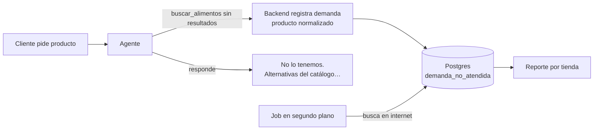

# Propuesta · Demanda no atendida (productos que la tienda no tiene)

Estado: **propuesta, pendiente de decidir.** No hay nada implementado. Antes del diseño
detallado faltan las respuestas de [Preguntas abiertas](#preguntas-abiertas).

Objetivo: cuando un cliente pide un producto que la tienda no tiene, **registrarlo y contarlo**.
Si muchos clientes lo piden, la tienda tiene datos para decidir si conviene tenerlo en stock.

Idea original: buscar en internet el producto que no está en la tienda. La recomendación
separa dos cosas: **registrar la demanda**, que es lo que cumple el objetivo, y **buscar en
internet**, que se hace fuera del chat.

---

## 1. Registrar la demanda (el núcleo)

El registro lo escribe el **backend**, no una tool que el agente decide usar. Es la misma razón
que D4 en `memoria_largo_plazo.md`: el agente puede olvidarse de llamarla, o alguien puede
manipularlo para inflar los números.

- **Cuándo se dispara:** `buscar_alimentos` no devuelve resultados, o el cliente nombra una
  marca o un producto que no está en el catálogo.
- **Normalizar es lo difícil.** "Royal Canin Mini Adult", "royal canin para perro chiquito" y
  "RC mini" tienen que contar como el mismo producto. Propuesta: una función LLM con salida
  estructurada (marca, línea, especie, etapa, presentación), como el extractor de memoria
  (`app/memory/long_term/extractor.py`). Se evalúa con aserciones duras, como
  `evals/run_evals_memoria.py`.
- **Contar sin inflar:** se cuenta una vez por sesión o cliente, no por mensaje. Si no, alguien
  que pregunta 50 veces, o un bot, distorsiona el ranking.
- **Separado por tienda:** el `tienda_id` sale del JWT. Las sesiones anónimas también cuentan,
  porque es un dato agregado sin datos personales (no se guarda el texto literal del cliente,
  solo el producto normalizado).
- **Dónde:** una tabla `demanda_no_atendida` en Postgres, con migración de Alembic. Campos
  tentativos: `tienda_id`, producto normalizado (marca, línea, especie, etapa, presentación),
  `thread_id` o `cliente_id` para deduplicar, `motivo` (no existe / sin stock), fecha.
- **Reporte por tienda:** los N productos más pedidos que la tienda no tiene, con cuántos
  clientes distintos los pidieron y en qué fechas.

Esto solo ya cumple el objetivo de decidir si conviene tener el producto en stock.

---

## 2. Buscar en internet: fuera del chat

Buscar en internet **en vivo dentro de la conversación** trae riesgos:

| Riesgo | Por qué |
|---|---|
| **Inyección indirecta (ASI01)** | El contenido de páginas web externas entra al contexto del agente. Una página puede traer instrucciones escondidas. Es el vector más difícil de controlar. |
| **Mandar al cliente a la competencia** | Si el agente muestra dónde comprarlo y a qué precio, la tienda pierde la venta. |
| **Información no verificada** | Precios, stock o composición de un producto de terceros pueden estar mal o desactualizados, y el agente los presentaría como ciertos. |
| **Costo y latencia** | Una llamada a una API de búsqueda en cada consulta que no encuentra nada. |

**Recomendación:** usar internet para **completar el registro de demanda, en segundo plano**.
Un proceso aparte (como el sweeper de memoria, o un job periódico) toma los productos pedidos
y busca marca, presentación, precio típico en el mercado y composición, para que la tienda
decida mejor. Ese contenido **nunca entra a la conversación del agente**.

---

## 3. Qué le dice el agente al cliente

"Ese producto no lo tenemos. Estas son alternativas parecidas de nuestro catálogo…", usando
la misma especie, etapa y proteína. Así la demanda se registra y la venta se intenta salvar.

**Fuera del primer alcance:** "te avisamos cuando llegue". Eso requiere guardar un contacto
(datos personales) y un consentimiento.

---

## Fases propuestas

1. **Registro y reporte:** detección en el backend, normalizador LLM con evals, tabla y
   migración, deduplicación, endpoint de reporte por tienda.
2. **Enriquecimiento con internet:** job en segundo plano con una API de búsqueda, sin pasar
   por el agente.
3. **(Opcional) Aviso al cliente** cuando el producto llegue, con consentimiento.

---

## Preguntas abiertas

1. **¿El cliente debe ver información de internet,** o basta con que la tienda la vea en el
   reporte? Recomendación: solo la tienda.
2. **¿Cómo consulta la tienda el reporte?** Un endpoint con su API key, un CSV, o un panel.
3. **¿Qué cuenta como "no está en la tienda"?** Solo lo que no existe en el catálogo, o también
   lo que existe pero está sin stock. Lo segundo es una señal de reposición, no de producto
   nuevo.
