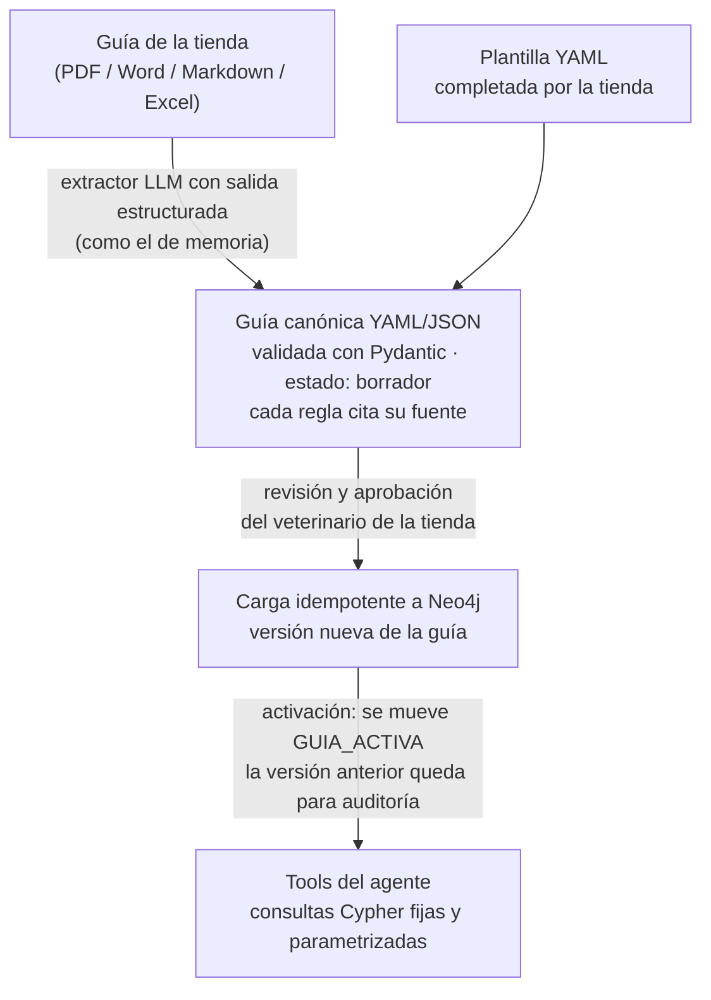

# Propuesta · Guía nutricional por tienda en Neo4j

Estado: **propuesta, pendiente de decidir.** No hay nada implementado. Antes de escribir el
diseño detallado faltan las respuestas de [Preguntas abiertas](#preguntas-abiertas).

Objetivo: que cada tienda tenga **su propia guía nutricional** (aprobada por su
veterinario), guardada como grafo en Neo4j. El agente la consulta según la tienda del token,
en vez de usar valores escritos en el código.

---

## Punto de partida

| Pieza | Estado actual |
|---|---|
| `data/conocimiento/guias_nutricion.md` | Placeholder con 4 porcentajes de ración por etapa (cachorro 4 %, adulto 2,5 %, senior 2 %) y las fórmulas de ración, duración y costo. Sin validar por un veterinario. |
| `app/tools/calcular_racion.py` | Repite esos porcentajes en `PORCENTAJE_DIARIO_POR_ETAPA`, escritos en el código. Iguales para todas las tiendas. |
| `graph_neo4j/` | Experimento aislado: el catálogo como grafo (`Producto`, `Especie`, `Etapa`, `TamanoRaza`, `Proteina`, `Ingrediente`). El agente no lo usa y no distingue tiendas. |
| Tiendas | Ya existen en Postgres (`tiendas`, UUID) y el `tienda_id` viaja en el JWT (`AuthContext.tienda_id`). |

---

## Recomendación

### 1. No convertir la guía directo a grafo con un LLM

Conviene pasar por un **formato canónico intermedio** que el veterinario revise y apruebe
antes de cargarlo:



**Por qué:**

- **Es contenido clínico.** Un porcentaje mal extraído o una contraindicación inventada
  dañan a una mascota. El blueprint exige que el veterinario de la tienda valide la guía. Un
  YAML se puede revisar, comparar entre versiones y guardar en git; un grafo generado
  directo por un LLM, no.
- **Ontología fija para todas las tiendas.** `LLMGraphTransformer` (LangChain) o el LLM
  Graph Builder de Neo4j crean nodos y relaciones distintos según el documento. Con
  tiendas diferentes, los grafos no se podrían consultar igual. Con un esquema fijo, el
  agente usa las mismas consultas para cualquier tienda.
- **Dos formas de entrada.** Una tienda ordenada completa la plantilla YAML y no hace
  falta el LLM. El extractor solo se usa para documentos libres.

### 2. Ontología propuesta

```
(:Tienda {id})-[:GUIA_ACTIVA]->(:Guia {version, estado, aprobada_por, fecha})
(:Tienda)-[:TIENE_GUIA]->(:Guia)                                    # todas las versiones

(:Guia)-[:DEFINE]->(:ReglaRacion {pct_peso_min, pct_peso_max, kcal_kg?})
    (:ReglaRacion)-[:PARA_ESPECIE]->(:Especie)
    (:ReglaRacion)-[:PARA_ETAPA]->(:Etapa)
    (:ReglaRacion)-[:PARA_TAMANO]->(:TamanoRaza)

(:Guia)-[:DEFINE]->(:ReglaCondicion {deriva_veterinario})-[:SOBRE]->(:Condicion {nombre})
    (:ReglaCondicion)-[:EVITAR]->(:Proteina | :Ingrediente | :Nutriente)
    (:ReglaCondicion)-[:PRIORIZAR]->(:Nutriente)                     # con rango en la relación

(:Guia)-[:DEFINE]->(:ReglaTransicion {dias, pasos})

(cualquier regla)-[:SUSTENTADA_EN]->(:Fuente {seccion, pagina, texto})   # trazabilidad
```

`Especie`, `Etapa`, `TamanoRaza`, `Proteina` e `Ingrediente` son **los mismos nodos** del
grafo del catálogo (`graph_neo4j/load_catalogo.py`). Esa es la ventaja de Neo4j: una sola
consulta responde *"productos aptos para un perro senior con enfermedad renal según la guía
de la tienda X"*, recorriendo condición → qué evitar → ingredientes → productos.

### 3. Separación entre tiendas

- La imagen es **Neo4j Community**, que admite **una sola base de datos de usuario**. Una
  base por tienda requiere Enterprise (de pago).
- Cada guía cuelga de su `(:Tienda {id})`, y **todas las consultas arrancan desde ese
  nodo**. El `tienda_id` sale del JWT, igual que en la memoria; nunca lo elige el LLM.
- Las reglas son de cada guía. Los nodos de vocabulario (especie, proteína, etc.) se
  comparten entre tiendas.
- **Versiones:** una versión nueva se carga como `borrador`. Activarla es mover
  `GUIA_ACTIVA` en una transacción: el cambio es atómico y volver atrás es trivial.

### 4. Cómo la usa el agente

Con **tools deterministas**, no con text2cypher (`GraphCypherQAChain`). Si el LLM arma el
Cypher, una inyección de prompt podría leer la guía de otra tienda.

- `calcular_racion` lee la `ReglaRacion` de la guía activa de la tienda, en lugar de
  `PORCENTAJE_DIARIO_POR_ETAPA`.
- Tool nueva `consultar_guia(especie, etapa, condiciones)`: devuelve qué evitar, qué
  priorizar y si corresponde derivar al veterinario. Así la derivación deja de depender
  solo del prompt (riesgo abierto de ASI01 en `vulnerabilidades.md`).
- `tienda_id` se pasa al construir las tools (`build_tools`), no como argumento que el LLM
  pueda completar.

### 5. Operación

- **Neo4j pasa a ser dependencia de producción** del servicio `api` (hoy es un experimento
  aislado). Hay que planear respaldo (volumen `neo4j_data`) y monitoreo.
- **Respaldo funcional:** si Neo4j no responde, o la tienda todavía no tiene guía activa, el
  agente usa la guía genérica actual, lo registra en logs y lo aclara en la respuesta.

---

## Antes de decidir

- **¿Hace falta Neo4j?** Para la guía de hoy (4 porcentajes) alcanza con una tabla en
  Postgres. Neo4j se justifica si las guías van a tener **condiciones, contraindicaciones e
  ingredientes cruzados con el catálogo**; ahí las consultas de varios saltos son su fuerte.
- **Costo operativo:** un tercer almacén (Redis + Postgres + Neo4j) que respaldar, migrar y
  monitorear.

---

## Fases propuestas

1. **Ontología y carga:** esquema Pydantic de la guía canónica, carga idempotente,
   `python -m scripts.cargar_guia --tienda <id> guia.yaml`, la guía actual como primer
   ejemplo y `calcular_racion` leyendo del grafo (con respaldo a la genérica).
2. **Extractor y aprobación:** de PDF/Markdown a YAML borrador con citas a la fuente, más el
   flujo de revisión y activación. Evals con aserciones duras, como `evals/run_evals_memoria.py`.
3. **`consultar_guia`:** condiciones y derivación, conectadas al grafo del catálogo.

---

## Preguntas abiertas

1. **¿En qué formato mandan las tiendas sus guías?** PDF, Word, Excel, o les damos una
   plantilla.
2. **¿Qué contenido van a tener, además de la ración?** Condiciones, contraindicaciones,
   transición de alimento, kcal por producto. De esto depende si Neo4j vale la pena.
3. **¿Quién aprueba la guía y por dónde?** Un script que corremos nosotros, o un endpoint de
   administración para cada tienda.
