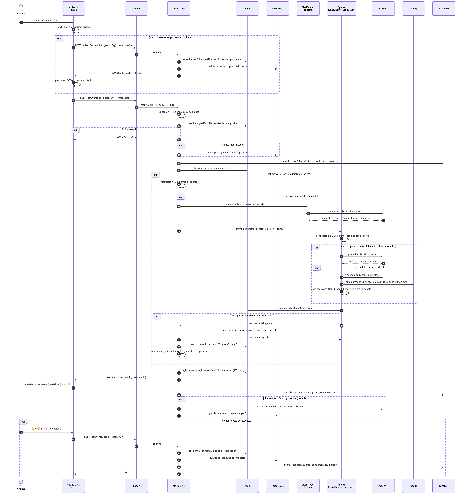
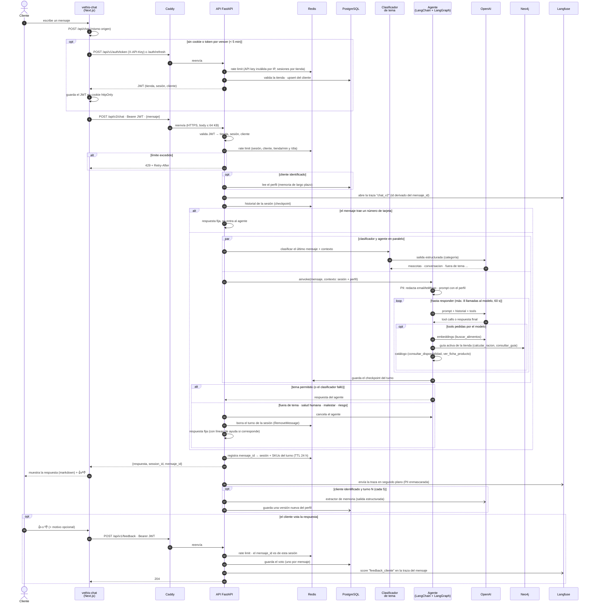

# Secuencia · Un mensaje del chat

Flujo completo de un mensaje desde el chat web (`vethis-chat`) hasta la respuesta del agente
por `POST /api/v2/chat`, y el voto 👍/👎 posterior. `/api/v1/chat` sigue el mismo flujo, con la
diferencia de que arma el agente en cada request.

La imagen se generó desde el bloque Mermaid de abajo (fuente editable); para regenerarla:
`npx @mermaid-js/mermaid-cli -i secuencia.mmd -o docs/img/secuencia_chat.png -s 2 -b white`.

## Notas

- **La API key de la tienda** solo la usa el servidor de `vethis-chat`; el navegador ve
  una cookie `httpOnly` con el JWT.
- **El historial** vive en Redis por sesión (TTL 30 min). El chat solo manda el mensaje
  nuevo en cada turno.
- **Si una tool o el modelo se pasan de un límite** (llamadas, tiempo), el turno se borra de
  la sesión y el cliente recibe un mensaje fijo.
- **Si Neo4j no responde**, `calcular_racion` y `consultar_guia` usan la guía por defecto.
- **Consolidación por inactividad:** además del turno N, un proceso de fondo consolida las
  sesiones que llevan 25 minutos sin mensajes (no aparece en el diagrama).
